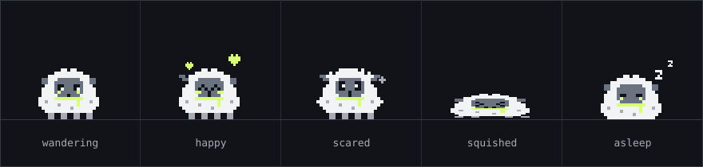

<p align="center">
  
</p>

<p align="center">
  <a href="https://kitloom.site"><b>kitloom.site</b></a>
  &nbsp;·&nbsp; <a href="#run-it">Run it</a>
  &nbsp;·&nbsp; <a href="#how-it-works">How it works</a>
  &nbsp;·&nbsp; <a href="#meet-purl">Meet Purl</a>
  &nbsp;·&nbsp; <a href="#the-logo">The logo</a>
  &nbsp;·&nbsp; <a href="CONTRIBUTING.md">Contribute</a>
</p>

---

**Kitloom is a free directory of setups for AI coding agents**: the instructions, rules,
skills, commands, sub-agents and hooks that make an agent work well in a project. Each
listing shows its README, its files, its licence and the agents its creator says it is
written for. Before you download one, Kitloom checks the repository for warning signs in your
browser.

Browsing and downloading need no account. Sign in to publish your own.

| Supported agents |  |
|---|---|
| **Primary** | Claude Code · OpenAI Codex · Cursor · Google Antigravity |
| **Also listed** | Gemini CLI · GitHub Copilot · Windsurf · opencode · Aider |

Compatibility is whatever a setup's creator declares. Kitloom does not test it, and says so.

## What you can do

- **Discover.** Search and filter by agent and category on Explore, or start from your tool on
  the Agents page.
- **Inspect.** Read a setup's README, browse its file tree (skills, rules, hooks and MCP config
  are labelled), and see its licence and where it came from.
- **Check and download.** The download button runs **Heddle**, Kitloom's pre-download check.
  It pins the repository to its latest commit, reads every text file at that commit, and
  reports warning signs: hidden instructions, commands that run on their own, credential
  access. Then you download exactly the commit it checked. Heddle reports findings. It never
  calls anything "safe", and every result comes with a "use at your own risk" notice.
- **Publish.** Point Kitloom at a public GitHub repository. It reads the README, file list,
  licence and default branch. You add a description, the agents it is for, and credits for
  the repositories it builds on. Update it by pushing to GitHub.

## Run it

Requires **Node.js 22** or newer.

```bash
npm install
cp .env.example .env.local   # then fill in the two Supabase values
npm run dev                  # http://localhost:3000
```

Only public values go in `.env.local`: the Supabase project URL, its publishable key, and
optionally a Cloudflare Turnstile site key. Without the Supabase values the site still runs,
but it has no listings, and sign-in and publishing are off.

| Command | What it does |
|---|---|
| `npm run dev` | Development server |
| `npm run build` | Static export to `out/`, then a per-page Content-Security-Policy |
| `npm run preview` | Serves `out/` locally, with the CSP applied |
| `npm run lint` | ESLint |
| `npm run typecheck` | TypeScript, strict |
| `npm test` | Unit tests: search and filters, URL safety, row mapping, Heddle's rules, Purl's sprites |
| `npm run check` | All of the above, then the build |

## How it works

```
 browser ──── Supabase (Auth + Postgres, Row Level Security)
    │
    ├──── api.github.com / raw.githubusercontent.com   (publish snapshot, Heddle)
    │
    └──── github.com/<owner>/<repo>/archive/<commit>.zip   (the download)
```

- **A static site.** Next.js App Router exported to plain files, served from a CDN. There is
  no server of its own: listing, search, sign-in, publishing and Heddle all run in the
  browser.
- **Every listing comes from the database.** Nothing is bundled into the site. Signed-in
  members publish at `/publish`, and setups are read from Supabase at `/setup?slug=…`.
- **The database is the security boundary.** The browser only holds the publishable key and
  a member's session. Row Level Security, column grants, check constraints and triggers decide
  who can write what, cap accounts at 25 setups, and rate-limit writes. All of it is versioned
  in `supabase/migrations/`, with role-simulation tests in `supabase/tests/`.
- **No uploads, no stored packages.** A setup is a public GitHub repository, and the download
  is the ZIP GitHub builds for the commit Heddle checked.
- **Sign-in** uses Supabase Auth with the PKCE flow: GitHub, Google, email and password, or a
  one-time emailed link. Passwords are handled only by Supabase.
- **Locked down.** Every page carries a Content-Security-Policy with hashed inline scripts and
  an allow-list of hosts. There are no analytics and no trackers.

Built with Next.js, React, TypeScript (strict), Tailwind CSS v4, Supabase, GSAP and Sonner.

## Meet Purl

<p align="center">
  
</p>

Purl is Kitloom's pet, a pixel-art lamb in a lime yarn scarf. Wool is where yarn starts, and a
purl is a knitting stitch. Purl lives in the empty corners of the site:

- **Under sidebars**, wandering about. Scroll so the space closes in and Purl gets scared,
  then squashed flat. Give it room again and it hops with relief. Hover it for hearts.
- **On the Agents page**, playing with each agent's logo, and racing to whichever row you
  point at.
- **On the About page**, at the loom in its workshop, weaving cloth into kits and filing them on
  the shelf, and knitting a scarf as you read.
- **On your account page**, chasing a ball of yarn and cheering when you save.
- **On your first visit**, trotting across the loading screen.

Purl is decorative. Screen readers skip it, it never blocks a click, and it stays still for
anyone who prefers reduced motion. The art in this README is generated from Purl's real
sprite data and the logo's shapes: `node scripts/readme/purl-art.mjs`.

## The logo

<p>
  
  &nbsp;&nbsp;
  
</p>

The mark is the **woolly k**: a lowercase k drawn as Purl. The stem is Purl's fleece, the arm
is Purl's head with its wool crown, lime eye and lime cheek, and the leg is the tail of Purl's
lime scarf, with a stripe and a fringe. It uses only lime `#D9FF72` and carbon `#111318`.
The wordmark is lowercase `kitloom` in Fredoka SemiBold.

| File | Use |
|---|---|
| [`public/brand/kitloom-logo.svg`](public/brand/kitloom-logo.svg) | The mark |
| [`public/brand/kitloom-logo-inverse.svg`](public/brand/kitloom-logo-inverse.svg) | Carbon tile, lime k: only on lime backgrounds |
| [`public/brand/kitloom-lockup.svg`](public/brand/kitloom-lockup.svg) | Mark and wordmark, for dark backgrounds |
| [`public/brand/kitloom-lockup-light.svg`](public/brand/kitloom-lockup-light.svg) | Mark and wordmark, for light backgrounds |
| [`src/app/icon.svg`](src/app/icon.svg), `favicon.ico`, `apple-icon.png` | Browser and home-screen icons |

The shapes are defined once in [`src/components/ui/logo.ts`](src/components/ui/logo.ts) and
drawn by the site's `LogoMark`. `node scripts/brand/purl-logo.mjs` regenerates the files above
(the `.ico` and `.png` are rasterised from `icon.svg`). Size, spacing and colour rules are in
[`design.md`](design.md) §5 "Wordmark". Please don't stretch, rotate or recolour it.

## Documents

| File | What it covers |
|---|---|
| [`CLAUDE.md`](CLAUDE.md) | Engineering rules, architecture and security model |
| [`design.md`](design.md) | Visual and interaction specification, motion, Purl, the logo |
| [`CONTRIBUTING.md`](CONTRIBUTING.md) | How to list a setup or change the site |
| [`docs/deployment.md`](docs/deployment.md) | Hosting, Supabase and sign-in provider setup |

## Licence

Kitloom's own source code, design, branding (including the logo) and Purl are proprietary: see [`LICENSE`](LICENSE).
You may read the code and fork it to propose changes, but not reuse it or run it as your own
product without permission.

Setups listed in the directory are not covered by that licence. They belong to their creators,
under the licence each one states. Agent names and logos belong to their owners and are used
only to identify each agent.
